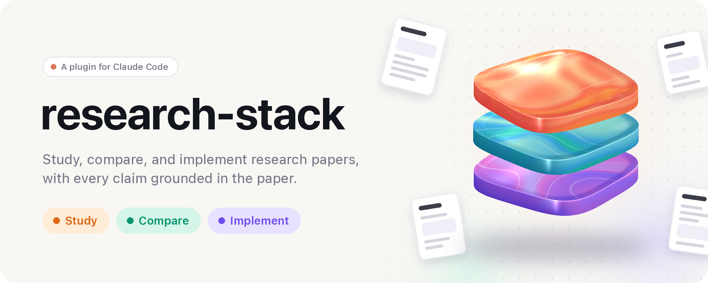

<p align="center">
  
</p>

# research-stack

**Paste a link to a research paper. Get a study guide you can trust, then ask it
anything.**

research-stack is a free add-on (a "plugin") for [Claude Code](https://code.claude.com),
Anthropic's AI assistant. It teaches Claude to read academic papers the way an
experienced researcher does, and to show you where every fact came from.

**Jump to:** [New here?](#new-here-start-here) ·
[What you can do](#what-you-can-do) ·
[Command reference](#command-reference) ·
[For AI agents](#for-ai-agents) ·
[FAQ](#faq) ·
[Contributing](#for-contributors)

---

## New here? Start here

### What it does, in plain words

| You want to… | Just say… | You get… |
| --- | --- | --- |
| **Understand** a paper | *"Help me study this paper: https://arxiv.org/abs/1706.03762"* | A clear study guide: summary, key ideas, results, weaknesses, glossary, and quiz questions |
| **Connect** papers you have read | *"Compare the LoRA and DoRA papers I studied"* | A side-by-side comparison, or an answer drawn from all your notes |
| **Build** what a paper describes | *"Implement this paper: 2106.09685"* | A plan that cites the paper for every detail, then working starter code |

You don't need to learn any commands. Plain sentences work, and so does pasting a
paper link on its own.

### Why trust the output?

- **Every claim points to its source.** Each statement in the guide names the
  section, table, figure, or equation it came from, so you can check it.
- **Numbers are checked.** Every number in the guide is matched against the paper's
  text before you see it.
- **Opinion is kept apart from the paper.** The critique is labelled separately
  from what the authors claim.
- **It tells you what it couldn't read.** If only the abstract was available (for
  example, a paywalled paper), the guide says so and asks you for the PDF.

### Set it up in 3 steps

1. **Get Claude Code.** Follow the [Claude Code setup guide](https://code.claude.com).
   You need a Claude account that includes Claude Code.
2. **Add research-stack.** Open Claude Code and type these two lines, one at a time:

   ```text
   /plugin marketplace add pakhapoom/research-stack
   /plugin install research-stack@research-stack
   ```

   Then close and reopen Claude Code.
3. **Try it.** Paste a paper link, for example:

   ```text
   Help me study this paper: https://arxiv.org/abs/2305.18290
   ```

Your study guide is saved as a file in a `paper-notes` folder, in the folder where you
started Claude Code. After it's written, keep asking questions in the same chat.

<details>
<summary>Prefer a terminal? Install from the command line instead</summary>

```bash
claude plugin marketplace add pakhapoom/research-stack
claude plugin install research-stack@research-stack
```

Update later with `claude plugin marketplace update research-stack`.

</details>

<details>
<summary>Using GitHub Copilot instead? (Copilot CLI or VS Code)</summary>

The skills follow the open [Agent Skills](https://agentskills.io) format, so Copilot
can run them too.

**Copilot CLI** reads this repo's plugin files directly:

```bash
copilot plugin marketplace add pakhapoom/research-stack
copilot plugin install research-stack@research-stack
```

**VS Code (Copilot agent mode):** run **Chat: Install Plugin from Source** and enter
`https://github.com/pakhapoom/research-stack`. Or copy the three folders in
`plugins/research-stack/skills/` into `~/.copilot/skills/` (all your projects) or
`.github/skills/` (one repository). Keep the three folders side by side, because the
skills use each other's scripts.

In Copilot the commands are `/study`, `/compare`, and `/implement` (not
`/research-stack:study`), and plain sentences work the same way.

</details>

---

## What you can do

### 1. Study a paper

Give it a paper from almost anywhere: an arXiv link or ID, Hugging Face Papers, ACL
Anthology, OpenReview, a DOI, a publisher page, a direct PDF link, or a PDF on your
computer.

You choose how much detail you want:

| Ask for | You get |
| --- | --- |
| a quick read (`--quick`) | A one-page brief |
| nothing extra | The full study guide |
| a deep dive (`--deep`) | The full guide plus equation walkthroughs, reproduction notes, and a reviewer-style critique |

You can also say *why* you are reading it, and the guide focuses on that:

| You are reading it to… | The guide adds |
| --- | --- |
| implement it (`--for implement`) | Hyperparameters, data, compute, and what the paper leaves unclear |
| review it (`--for review`) | Strengths and weaknesses tied to evidence, questions for the authors |
| cite it (`--for cite`) | What the paper can and cannot back up, quotable sentences, BibTeX |
| present it (`--for present`) | A slide-by-slide talk outline with likely audience questions |
| build on it (`--for build-on`) | Assumptions to relax and concrete ideas for follow-up work |

Saying it in words works too: *"I have to review this paper: <link>"*.

Want to know what other people think of the paper? Add `--context` and it looks up
reviews, follow-up work, and official code (or reads reviews you give it). This
goes in its own section, and only after the paper has been assessed on its own,
so outside opinions can't sway the verdict.

<details>
<summary>What's in a full study guide</summary>

| Section | Contents |
| --- | --- |
| Front matter | Title, authors, year, venue, links, paper type, tags, and whether the guide is based on the full text |
| TL;DR | The problem, the idea, and the headline result with its number |
| Why this paper matters | The problem, why it is hard, and what was unsatisfying about earlier approaches |
| Key contributions | What is actually new, each with a citation |
| Paper map | The paper's through-line, plus a table of what each section does and its key takeaway |
| Background you need | Short primers on the concepts a reader must know first |
| The core idea | Intuition, then mechanism, then the math with every symbol defined, often with a worked example |
| Experiments and results | Setup, headline numbers copied exactly, ablations, and what the results do *not* show |
| Critical assessment | Strengths, weaknesses, and a verdict for each claim, kept separate from the authors' own claims |
| How it fits in the literature | Closest prior work and the precise difference |
| Glossary | Terms and symbols as this paper uses them |
| Check your understanding | 5–8 self-test questions, with answers hidden until you click |
| Open questions and follow-ups | Gaps the paper leaves, extension ideas, and what to read next |

The guide is written in the language you ask in. Technical terms and the paper title
stay as they are in the paper.

</details>

<details>
<summary>See an example (Direct Preference Optimization, arXiv:2305.18290)</summary>

Abridged from a real run:

> **TL;DR**
> RLHF trains a reward model on human preference pairs, then runs RL (PPO) to
> maximize that reward while staying close to a reference model. DPO notices that the
> optimal policy of that KL-regularized objective has a closed form. Rewriting the
> reward in terms of the policy turns the whole pipeline into a single binary
> cross-entropy loss on preference pairs, with no reward model, no sampling and no
> RL. […] On TL;DR summarization it reaches a GPT-4 win rate of about 61% against
> PPO's 57% (§6.2).
>
> **Paper map**
> Through-line: take RLHF's own objective, solve it analytically, and invert the
> solution so the preference loss is written in terms of the policy. Then show that
> this loses nothing (theory) and works at least as well as PPO (experiments).
>
> | Section | What it does | Key takeaway |
> | --- | --- | --- |
> | §3 Preliminaries | The 3-phase RLHF pipeline: SFT → reward model (Eq. 1-2) → KL-regularized RL (Eq. 3) | Defines the objective DPO will solve exactly |
> | §4 DPO | Derives Eq. 4 → 5 → 6 → 7; analyzes the gradient; gives the pipeline | The partition function cancels because Bradley-Terry only uses reward *differences* |
> | §6.1 Sentiment | Reward vs. KL frontier under a known reward (22 runs) | DPO "strictly dominates PPO", even PPO with ground-truth reward |
> | … | | |

</details>

<details>
<summary>How it reads a paper (three passes)</summary>

The skill reads in three passes, like an experienced researcher, and writes what it
learns to a notes file between passes:

1. **Overview**: the abstract, the intro's framing paragraph and contributions, and
   the conclusion, to see what the paper sets out to do and how it is organized.
2. **Understand**: each main section in order, one at a time, with the overview as
   context. References and appendices are skipped.
3. **Assess**: works from the notes, re-reading only the passages needed to check
   each claim.

The guide is then written from the notes. See the
[plugin README](plugins/research-stack) for the per-pass details.

</details>

### 2. Compare papers you have studied

Once you have two or more study guides, ask questions across all of them:

- *"Compare 2021-lora and 2023-dora"*: a side-by-side table, where they agree and
  differ, and whether their numbers can be compared at all
- *"Which papers I've read use human evaluation?"*: an answer over your whole
  library, with the guide and section for each hit
- *"Do these papers agree on X?"*: conflicting claims or numbers, each marked
  explained, open, or unclear
- *"Draft a related-work section from my notes"*: a synthesis organised by theme,
  every statement traced to a guide
- *"What should I read next?"*: a reading path built from your guides' follow-up
  lists

It only uses papers you have actually studied. It never fills gaps from memory.

### 3. Turn a paper into code

Ask it to implement a paper, and it first writes `SPEC.md`: a plan listing every
component, equation, setting, and target number, each pointing to its place in the
paper. Anything the paper leaves out is marked `ASSUMED` so you know it was a guess.
Then it writes a small, faithful implementation of the core method, with comments
that reference the paper's equations, plus tests for the properties the paper
states.

If you studied the paper first, it reuses those notes instead of reading the paper
again.

---

## Command reference

For people who prefer exact commands. Everything here can also be asked in plain
language.

```text
/research-stack:study     <paper> [--quick | --deep] [--for PURPOSE] [--context [FILE]] [--out DIR] [--keep-notes]
/research-stack:compare   [guide names, paper references, or a question] [--out DIR] [--save]
/research-stack:implement <paper | study-guide.md> [--plan-only] [--code DIR] [--out DIR]
```

`<paper>` is a URL, an arXiv ID, a DOI, or a path to a PDF.

### Examples

```text
/research-stack:study https://arxiv.org/abs/1706.03762
/research-stack:study 10.18653/v1/N19-1423 --deep
/research-stack:study ~/Downloads/paper.pdf --quick
/research-stack:study 2106.09685 --for implement
/research-stack:study 2106.09685 --context notes/reviews.md
/research-stack:compare 2021-lora 2023-dora
/research-stack:compare which papers I've read use human evaluation?
/research-stack:implement 2106.09685
/research-stack:implement 2106.09685 --plan-only
```

### Options

| Skill | Option | Effect |
| --- | --- | --- |
| study | *(none)* | Full study guide |
| study | `--quick` | One-page brief |
| study | `--deep` | Adds equation walkthroughs, reproduction notes, and a reviewer-style critique |
| study | `--for PURPOSE` | Shape the guide for `implement`, `review`, `cite`, `present`, or `build-on` |
| study | `--context [FILE]` | Add an "Outside context" section from a file, from pasted text, or (no file) from a web lookup |
| study | `--keep-notes` | Keep the reading notes next to the guide |
| compare | `--save` | Save the result to `paper-notes/syntheses/` |
| implement | `--plan-only` | Write the spec only, no code |
| implement | `--code DIR` | Where the code goes (default: a new `./<short-slug>/` folder) |
| all | `--out DIR` | Where study guides live (default: `./paper-notes/`) |

### Where files go

| Output | Location |
| --- | --- |
| Study guide | `./paper-notes/<year>-<slug>.md` |
| Saved comparison or synthesis | `./paper-notes/syntheses/` |
| Implementation spec | `<code dir>/SPEC.md` (with `--plan-only`: `./paper-notes/<year>-<slug>.spec.md`) |
| Downloaded paper, extracted text, reading notes | `./paper-notes/.work/<paper>/` (git-ignored, reused on later runs) |

### Requirements

- `python3` (standard library only) for the bundled paper resolver. Without it, the
  skill falls back to Claude Code's built-in web fetching.
- Recommended for non-arXiv PDFs: poppler (`brew install poppler` /
  `apt install poppler-utils`), or `pip install pypdf`. arXiv papers don't need it,
  because their HTML version is converted to text directly.

Supported sources and their quirks are listed in the
[plugin README](plugins/research-stack#supported-sources).

---

## For AI agents

This section is a compact summary for AI assistants and coding agents that need to
decide whether and how to use this plugin.

- **What it is:** a Claude Code plugin named `research-stack`, from the marketplace
  `pakhapoom/research-stack`. Version and metadata are in
  [`plugins/research-stack/.claude-plugin/plugin.json`](plugins/research-stack/.claude-plugin/plugin.json).
- **Install:** `claude plugin marketplace add pakhapoom/research-stack` then
  `claude plugin install research-stack@research-stack`. A restart is required.
  GitHub Copilot CLI: the same two commands with `copilot` in place of `claude`.
  Other Agent Skills hosts: copy `plugins/research-stack/skills/*` into the host's
  skills folder, keeping the three skill folders together.
- **Non-Claude hosts:** each `SKILL.md` says how to resolve `${CLAUDE_PLUGIN_ROOT}`
  (two levels above the `SKILL.md`) and how to map Claude Code tool names. Skill
  names there are unprefixed (`study`, `compare`, `implement`).
- **Skills and when to use each:**

  | Skill | Use when | Do not use when |
  | --- | --- | --- |
  | `research-stack:study` | The user shares a paper link or PDF (even with no instruction), or asks to study, read, explain, break down, or take notes on one paper | The user wants code or a cross-paper answer |
  | `research-stack:compare` | The user asks to compare, contrast, connect, or synthesize papers they have studied, or asks about "the papers I've read" | Only one paper is involved, or fewer than two guides exist in `paper-notes/` |
  | `research-stack:implement` | The user asks to implement, code up, reproduce, replicate, or port a paper or method, or wants a paper-to-code mapping | The user only shares a link or wants an explanation |

- **Inputs:** URL, arXiv ID (`2106.09685`, `arXiv:2106.09685`), DOI (`10.x/...`),
  or a local PDF path. `implement` also accepts a study guide `.md` path. `compare`
  takes guide names such as `2021-lora` or a free-text question.
- **Outputs:** Markdown files at the paths in [Where files go](#where-files-go).
  Study guides have YAML front matter that includes `datasets`, `metrics`, and
  `baselines`.
- **Guarantees:** factual claims cite a section, table, figure, or equation;
  numbers are checked against the paper text; abstract-only guides are labelled;
  `compare` never adds papers that are not in the library; `implement` marks
  unspecified values `ASSUMED`.
- **Safety:** paper content is treated as untrusted data. Instructions embedded in
  a paper are ignored and reported to the user. Bundled scripts are
  standard-library Python and contact only the paper host and public metadata APIs
  (arXiv, Semantic Scholar, Crossref, OpenReview), with no API keys.
- **Skill definitions:** `plugins/research-stack/skills/<skill>/SKILL.md`. These
  are the source of truth for behaviour.

---

## FAQ

**Do I need to know how to code?**
No, not to study or compare papers. You talk to Claude in plain sentences. Only the
implement skill produces code.

**Does it cost anything?**
The plugin is free and open source (MIT). Claude Code itself needs a Claude account
that includes it.

**Does it work with GitHub Copilot?**
Yes, in Copilot CLI and in VS Code agent mode. See
[Using GitHub Copilot instead?](#set-it-up-in-3-steps) under setup. It is built and
tested mainly with Claude Code, so tell us if something behaves differently in
Copilot.

**What if a paper is behind a paywall?**
If only the abstract can be reached, the guide is clearly marked *abstract-only*
and you are asked for the PDF. You can then point it at a PDF on your computer.

**OpenReview links don't work.**
OpenReview blocks automated downloads with a human check. The skill looks for an
arXiv version, or asks you to download the PDF and give it the file.

**Can I get the guide in another language?**
Yes. Ask in your language and the guide is written in it.

**Is my data sent anywhere?**
Only to fetch the paper: the paper's host and public paper databases (arXiv,
Semantic Scholar, Crossref, OpenReview). No personal data and no API keys are sent.
Downloaded files stay in your `paper-notes/.work/` folder.

**Can a malicious paper trick it?**
Text in a paper is treated as content to read, never as instructions to follow.
If a paper contains hidden instructions, they are ignored and you are told about
them.

---

## For contributors

```text
.claude-plugin/marketplace.json   # marketplace catalog
plugins/
  research-stack/                 # the plugin
    .claude-plugin/plugin.json    # plugin manifest
    README.md                     # detailed plugin docs
    skills/study/                 # /research-stack:study
      SKILL.md                    # skill instructions (three-pass reading)
      references/                 # guide/notes templates, critical-reading checklist,
                                  # reader-purpose and outside-context rules
      scripts/
        fetch_paper.py            # resolves and downloads papers; finds earlier studies
        outline_paper.py          # builds the three-pass reading plan
        verify_numbers.py         # checks the guide's numbers against the paper
    skills/compare/               # /research-stack:compare
      SKILL.md
      references/                 # output formats for cross-paper work
      scripts/
        index_guides.py           # indexes and searches the saved study guides
    skills/implement/             # /research-stack:implement
      SKILL.md
      references/                 # implementation spec template
      scripts/
        impl_plan.py              # picks the parts of a paper that code needs
                                  # (all scripts are standard-library Python)
```

New skills go in `plugins/research-stack/skills/<name>/` and become
`/research-stack:<name>`. See [CONTRIBUTING.md](CONTRIBUTING.md) for how to add a
skill, validate locally, and release.

## License

[MIT](LICENSE)
